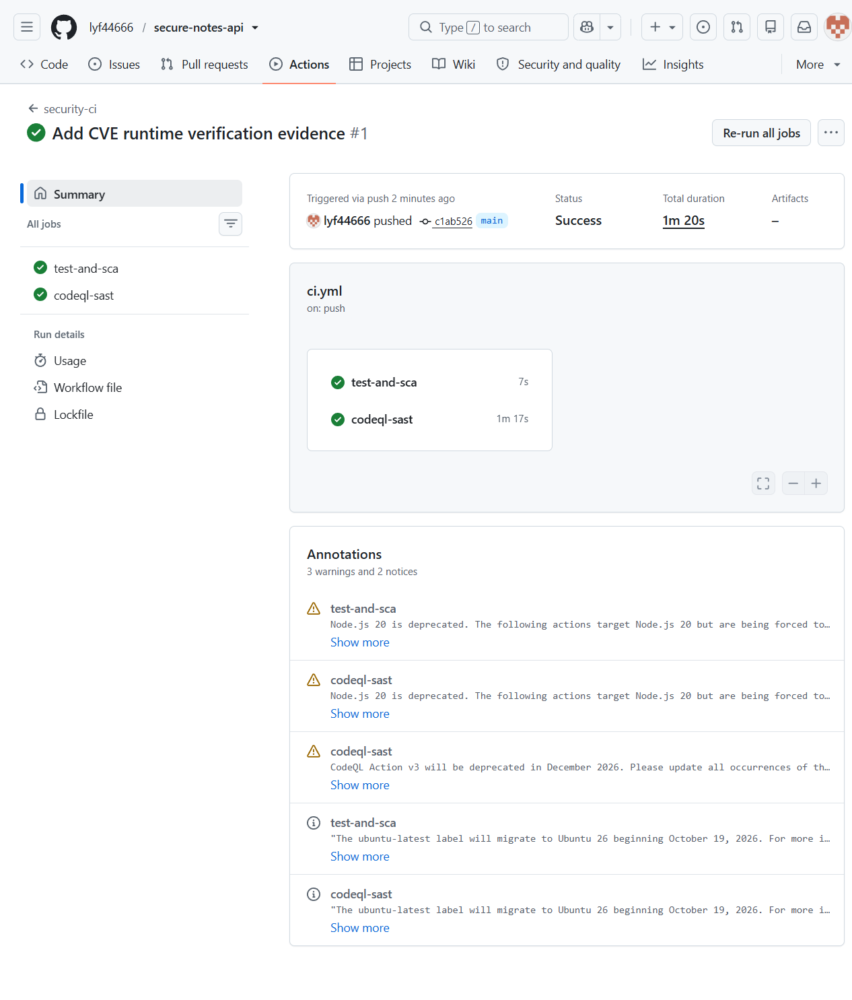
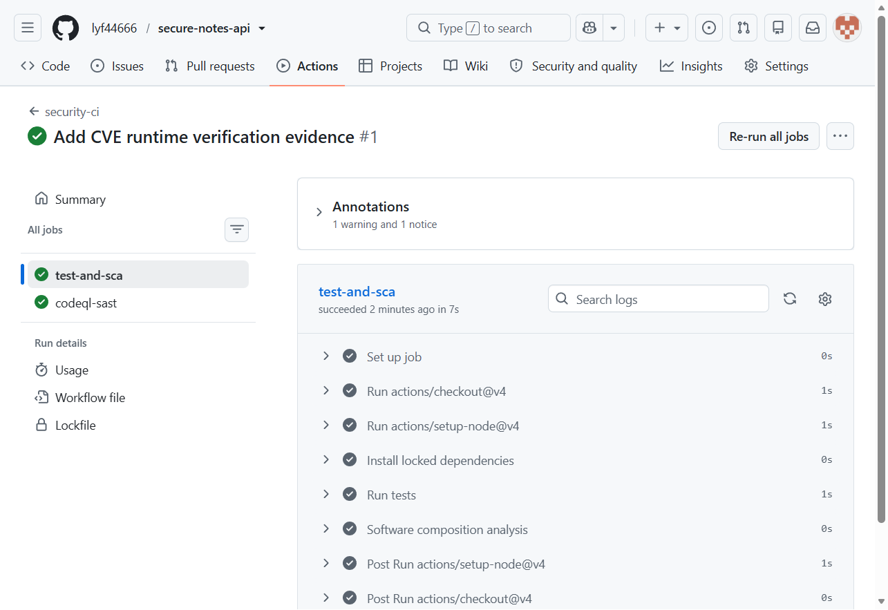
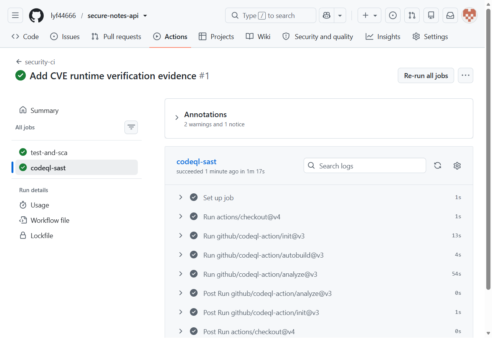

# Secure Notes REST API

Educational REST API implementing the Work 1 requirements with no third-party
runtime dependencies. It uses Node.js 24, the built-in node:sqlite driver,
HS256 JWT issuance and verification, scrypt password hashing, prepared SQL
statements, output escaping, login rate limiting, and an audit log.

## Endpoints

| Method | Path | Access | Purpose |
|---|---|---|---|
| GET | /health | Public | Health check |
| POST | /auth/login | Public | Verify credentials and issue a short-lived JWT |
| GET | /api/data | Bearer JWT | Return users, notes, and the authenticated caller |
| POST | /api/notes | Bearer JWT | Create an escaped note owned by the caller |

## Run and test

~~~bash
npm ci
npm test
PORT=3000 JWT_SECRET="replace-with-a-random-secret-at-least-32-characters" npm start
~~~

The in-memory demo database creates two users:

| Username | Password | Role |
|---|---|---|
| admin | Admin-Demo-2026! | admin |
| analyst | Analyst-Demo-2026! | analyst |

These credentials exist only for the educational demonstration. Replace them
for any deployment outside a local test environment.

## curl verification

~~~bash
curl -i http://localhost:3000/health

curl -i -X POST http://localhost:3000/auth/login \
  -H "Content-Type: application/json" \
  -d '{"username":"analyst","password":"Analyst-Demo-2026!"}'

curl -i http://localhost:3000/api/data

TOKEN="<token from the login response>"
curl -i http://localhost:3000/api/data \
  -H "Authorization: Bearer $TOKEN"

curl -i -X POST http://localhost:3000/api/notes \
  -H "Content-Type: application/json" \
  -H "Authorization: Bearer $TOKEN" \
  -d '{"content":""}'
~~~

The final request returns the escaped entity sequence for the image payload.
The database stores the original text; every API response applies HTML
escaping.

## Security implementation

### SQL injection

All user-controlled values enter SQLite through prepare() placeholders. The
test "SQL injection login payload does not bypass authentication" submits
' OR 1=1-- and requires a 401 response.

### Cross-site scripting

Every user-controlled value returned by the API passes through escapeHtml().
The API also sends a deny-by-default Content-Security-Policy, nosniff, DENY
framing, and a same-origin resource policy. The XSS regression test submits an
image event-handler payload and verifies that the response contains only
escaped entities.

### Authentication and authorization

- Passwords use a unique 16-byte salt and scrypt with N=16384, r=8, p=1.
- Login issues an HS256 JWT with sub, username, role, iat, exp, iss, and aud.
- Protected routes require a valid signature, issuer, audience, expiry, and a
  current user record.
- Signature and password comparisons are constant-time.
- Login attempts are rate-limited per source address.
- Authentication failures return one generic message to reduce account
  enumeration.

### Additional controls

- JSON content type enforcement and a 32 KiB request limit.
- Input normalization and maximum lengths.
- Generic 500 responses without stack traces or database details.
- Security headers on every response.
- Append-only audit entries for authentication and note creation events.
- No third-party runtime packages, which removes a large dependency supply
  chain from the local demonstration.

## CI/CD pipeline

.github/workflows/ci.yml runs on every push and pull request:

1. npm ci --ignore-scripts installs only the lockfile contents.
2. npm test runs API and security regression tests.
3. npm audit --audit-level=high performs software composition analysis.
4. CodeQL performs static application security testing.

The public repository is https://github.com/lyf44666/secure-notes-api.
The workflow runs on every push. The first successful run is recorded at
https://github.com/lyf44666/secure-notes-api/actions/runs/39198167716.

## CVE analysis

The selected vulnerability is CVE-2021-41773, a path traversal and potential
remote code execution vulnerability in Apache HTTP Server 2.4.49. The complete
reproduction and fixed environment are in vulhub/CVE-2021-41773.

The vulnerable container exposes /etc/passwd through a percent-encoded
traversal. The fixed environment upgrades to Apache 2.4.51 and denies
filesystem access by default. Run the supplied scripts on a machine with
Docker and attach the resulting terminal screenshots to the report.
